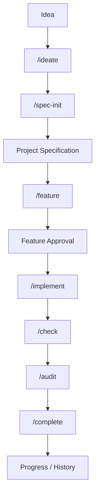

# Viker's BuildKit

**An AI development operating system for building software with coding agents.**

[](https://www.npmjs.com/package/vikers-buildkit)
[](https://github.com/vikersjunior/v-buildkit/actions/workflows/ci.yml)
[](https://opensource.org/licenses/MIT)

Viker's BuildKit is an installable development operating system that brings structure, spec-driven discipline, feature gating, security reviews, and capability management to AI coding agents.

---

## Quick Start

Run inside any new or existing project:

```bash
npx vikers-buildkit
```

Or use the short CLI alias:

```bash
npx v-buildkit
```

BuildKit automatically detects your project environment and active AI coding agents, prompts for confirmation, and installs the workflow system safely without modifying existing project files.

---

## What is Viker's BuildKit?

AI coding agents excel at writing code, but large software projects often suffer from:

- **Context Drift**: Agents losing sight of project goals over time.
- **Specification Decay**: Requirements abandoned once coding begins.
- **Feature Creep**: Unbounded changes without clear acceptance criteria.
- **Unverified Releases**: Lack of mandatory quality and security checks.
- **Vendor Lock-in**: Workflows tied to a single AI coding tool.

**Viker's BuildKit solves this by separating roles:**

```text
AI Coding Agent
    ↓
Does the coding & implementation

Viker's BuildKit
    ↓
Provides the development operating system around the agent
```

BuildKit introduces a spec-anchored lifecycle, a 70-skill inert capability catalog across 7 departments, feature-gated execution contracts, and multi-agent compatibility.

> 📖 **Learn how to get the most out of BuildKit** → Read the complete [Using Viker's BuildKit Effectively](docs/effective-usage.md) guide.

---

## The Development Lifecycle

BuildKit guides your AI coding agent through a structured lifecycle from concept to completed feature:



### Lifecycle Stages

- **`/ideate`**: Converge a vague idea into a crisp project scope.
- **`/spec-init`**: Generate the six core project specification files and match relevant tools from the capability catalog.
- **`/feature`**: Define a bounded implementation contract with acceptance criteria (no code edits allowed).
- **`/implement`**: Execute approved tasks following project rules and coding standards.
- **`/check`**: Verify implemented behavior against acceptance criteria.
- **`/audit`**: Enforce mandatory quality, architecture, accessibility, and security checks.
- **`/complete`**: Archive feature evidence and update project progress logs.

---

## Supported Agents

BuildKit integrates natively with all major AI coding tools:

| Agent | Integration Path | Detection Signals |
|---|---|---|
| **Claude Code** | `.claude/skills/` | `.claude/skills`, `CLAUDE.md`, `.claude/settings.json`, `claude` CLI |
| **Codex CLI** | `.agents/skills/` | `.agents/skills`, `AGENTS.md`, `codex` CLI |
| **Antigravity Agent** | `.agents/skills/` | `.agents/skills`, `AGENTS.md`, `antigravity` CLI |
| **Cursor** | `.cursor/skills/` | `.cursor/skills`, `.cursor`, `cursor-agent` CLI |
| **Gemini CLI** | `.gemini/skills/` | `.gemini/skills`, `.gemini`, `gemini` CLI |
| **GitHub Copilot** | `.github/skills/` | `.github/skills`, `.github/copilot-instructions.md`, `copilot` CLI |
| **Grok** | `.grok/skills/` | `.grok/skills`, `.grok`, `grok` CLI |
| **OpenCode** | `.opencode/skills/` | `.opencode/skills`, `.opencode`, `opencode` CLI |
| **Kiro** | `.kiro/skills/` | `.kiro/skills`, `.kiro`, `kiro` CLI |
| **Trae** | `.trae/skills/` | `.trae/skills`, `.trae`, `trae` CLI |
| **Rovo Dev** | `.rovodev/skills/` | `.rovodev/skills`, `.rovodev`, `rovodev` CLI |
| **Qoder** | `.qoder/skills/` | `.qoder/skills`, `.qoder`, `qoder` CLI |
| **Mistral Vibe** | `.vibe/skills/` | `.vibe/skills`, `.vibe`, `vibe` CLI |

---

## Installation Options

### Interactive Setup (Default)

```bash
npx vikers-buildkit
```

### Install in Specific Target Directory

```bash
npx vikers-buildkit install ./my-project
```

### Explicit Agent Selection

```bash
npx vikers-buildkit install . --agent claude
```

### Multi-Agent Installation

```bash
npx vikers-buildkit install . --agent claude,codex,cursor
```

### Linked Mode (`--link`)

Share one canonical `.buildkit/workflow-skills/` directory across multiple coding agents using relative symlinks (Unix) or directory junctions (Windows):

```bash
npx vikers-buildkit install . --agent claude,codex,cursor --link
```

### Scripted / Non-Interactive (CI)

```bash
npx vikers-buildkit install . --agent codex --no-detect
```

### Include Starter Specification Templates

```bash
npx vikers-buildkit install . --with-blank-templates
```

---

### Configurable Project Documentation Root

Specify where BuildKit-managed project documentation lives using `--docs-dir`:

```bash
npx vikers-buildkit install . --docs-dir docs/buildkit
```

Or configure it interactively during installation. BuildKit stores configuration in `.buildkit/config.json`:

```json
{
  "schemaVersion": 1,
  "docs": {
    "root": "docs/buildkit"
  }
}
```

---

## Project Structure & State Architecture

BuildKit separates human-facing project specifications from execution state:

```text
my-project/
├── docs/
│   └── buildkit/                 — Configurable Project Documentation Root (Source of Truth)
│       ├── PRD.md               — Product Requirements Document
│       ├── architecture.md     — System Architecture & Component Design
│       ├── Tech_stack.md       — Technology Stack & Promoted Capability Tools
│       ├── Implementation_plan.md — Execution Phases & Task Checklists
│       ├── rules.md            — Coding Guidelines & Security Guardrails
│       └── Progress.md         — Project Progress & Feature Audit Log
│
├── .buildkit/                     — BuildKit Execution & State Layer (Root)
│   ├── config.json               — BuildKit Project Configuration (docs.root)
│   ├── agent.md                  — Active Agent Configuration
│   ├── agent-capabilities.json   — Environment Capability Evidence
│   ├── workflow-skills/          — Canonical BuildKit Workflow Skills
│   ├── skills-library/           — 70-Skill Catalog (Inert until promoted)
│   ├── features/                 — Approved Feature Contracts
│   ├── history/                  — Execution History Logs
│   ├── audits/                   — Security & Quality Audit Reports
│   ├── findings.md               — Findings Ledger (gates /complete and lint)
│   ├── bin/lint.js               — Vendored Lint Checker (with lib/)
│   ├── decisions/                — Architectural Decision Records (ADRs)
│   └── rollbacks/                — Rollback Recovery Checkpoints
│
├── .claude/skills/               — Native Active Agent Skills Directory
└── src/                          — Project Application Source Code
```

---

## Agent Capability Signals

BuildKit records evidence about the project and local environment in `.buildkit/agent-capabilities.json`:

```json
{
  "schemaVersion": 1,
  "platform": "darwin",
  "node": "v20.11.0",
  "note": "Capabilities are evidence-based signals, not guarantees of vendor behavior.",
  "agents": [
    {
      "agent": "claude",
      "nativeSkills": true,
      "projectInstructions": true,
      "cliDetected": true,
      "shell": true,
      "git": true,
      "mcpEvidence": true,
      "parallelWorkEvidence": true
    }
  ]
}
```

Workflows use these signals to make safe decisions rather than assuming every coding agent behaves identically.

---

## Workflow Commands

Run these workflow skills directly inside your AI coding agent environment:

| Workflow Command | Purpose |
|---|---|
| **`/ideate`** | Explore and refine a vague product idea into a clear scope. |
| **`/spec-init`** | Generate the 6 core specification files and match capability skills. |
| **`/feature`** | Draft and approve a bounded implementation contract. |
| **`/implement`** | Execute an approved feature contract following project rules. |
| **`/check`** | Verify implementation against acceptance criteria. |
| **`/audit`** | Perform quality, architecture, accessibility, and security reviews. |
| **`/complete`** | Formally close a feature, record history, and log progress. |
| **`/progress`** | Read out current project progress and feature status. |
| **`/spec-review`** | Check specification files for internal drift. |
| **`/tools-check`** | Audit active capability skills against project requirements. |
| **`/distill-skill`** | Extract transferable project knowledge into a reusable agent skill. |

---

## Maintenance Commands

Manage, inspect, and update BuildKit installations via the CLI:

### Status

Check installation health, configured agents, symlinks, and specification files:

```bash
npx vikers-buildkit status
```

### Doctor

Run an automated diagnostic audit on BuildKit state and skill integrity:

```bash
npx vikers-buildkit doctor
```

*(Exits with status code `1` if health issues are found).*

### Update

Safely update workflow skills and capability libraries to the latest BuildKit version:

```bash
npx vikers-buildkit update --dry-run   # preview: add / update / remove / conflict per file
npx vikers-buildkit update
```

*BuildKit preserves all user specification files, custom user skills, and feature history during updates.*

BuildKit records a SHA-256 hash of every file it installs in `.buildkit/manifest.json`. On update, a managed file is replaced or removed only if it still matches that hash. If you edited a BuildKit skill, update stops without changing anything and lists the conflicts. Re-run with `--force` to back the edited files up to `.buildkit/backups/<timestamp>/` and replace them (backups are git-ignored, and the newest five runs are kept). Files a new release drops are removed only if you never edited them. An install made before change tracking existed has no record to compare against, so its first update backs up and replaces any file that differs.

### Repair

Restore broken symlinks/junctions or missing BuildKit files:

```bash
npx vikers-buildkit repair
```

### Tokens

Estimate how many context tokens each workflow command loads (skill body plus the project files it reads), so you can see which specs are growing expensive:

```bash
npx vikers-buildkit tokens
```

*Estimates use ~4 characters per token; real counts vary by model.*

### Lint

Check the spec files for drift without spending model tokens. Lint is read-only: it never writes files or creates the target directory.

```bash
npx vikers-buildkit lint
```

| Check | Result |
|---|---|
| Some but not all six spec files exist | FAIL |
| No spec files yet (before `/spec-init`) | WARN |
| A template placeholder such as `[Project Name]` or `[TBD]` is left in a spec | FAIL |
| `Progress.md`'s Current Phase is not a phase heading in `Implementation_plan.md` | FAIL |
| A `**Assumption:**` tag is still in a spec | WARN |
| `.buildkit/state.md` names a feature with no feature or history folder | WARN |
| A `BLOCKING` finding in `.buildkit/findings.md` is `open` or `fixed` | FAIL |
| A malformed or duplicate finding header, or an `accepted`/`invalid`/`closed` finding missing its `Reason`, `Accepted by` or `Verified in` line | FAIL |
| An audit report names a finding ID the ledger lacks, or rated an open finding higher than the ledger does | FAIL |
| The ledger or an audit report exists but can't be read | FAIL |
| A ledger line matches a common credential pattern (private key, AWS, GitHub, OpenAI or Slack token) | WARN |

Findings about a line in a file give the file and line number. Lint exits with status `1` when any check fails, so it works as a CI step. In CI, add `--strict` so that a missing BuildKit install or a project with no specs fails too (without it, both are only warnings, which suits a fresh project before `/spec-init`):

```yaml
- name: Check BuildKit specs
  run: npx vikers-buildkit lint --strict
```

### Findings Ledger

`/audit` records every finding in `.buildkit/findings.md` under a durable ID, and its timestamped report lists the IDs:

```
### F-001 [BLOCKING] open — SQL built from request input in /api/search
- Where: src/api/search.ts:42
- Detail: one or two lines naming the problem.
```

Statuses are `open`, `fixed` (set by `/implement`), `closed` (set by `/audit`, with `- Verified in: <report>`), `accepted` (your decision, with `- Reason:` and `- Accepted by:`) and `invalid` (with `- Reason:`). A `BLOCKING` finding that is `open` or `fixed` blocks completion anywhere in the project. `/complete` runs `node .buildkit/bin/lint.js`, the copy of lint installed with the skills, and refuses on a non-zero exit, so any lint failure blocks completion. The ledger is committed with the rest of `.buildkit/`, so it names locations, never secrets.

---

## Safety & Non-Destructive Guarantees

BuildKit is designed to be safe for existing codebases:

1. **Non-Destructive Skill Copying**: BuildKit recursively merges workflow skills (`fs.cpSync`) instead of deleting directories. Custom user skills (e.g. `.claude/skills/my-custom-skill/`) are never removed.
2. **Template Preservation**: Starter templates (`--with-blank-templates`) will never overwrite existing specification files (`PRD.md`, etc.).
3. **Execution State Isolation**: Execution logs in `.buildkit/features/` and `.buildkit/history/` are strictly preserved across installations and updates.

---

## Workflow Example

### Adding a Feature with BuildKit

Instead of giving an agent a vague prompt like *"add payment checkout"*:

1. **Define Contract**: Run `/feature payment-checkout`. The agent drafts explicit acceptance criteria, security requirements, and file bounds in `.buildkit/features/payment-checkout.md`.
2. **Review & Approve**: Review the feature contract and give explicit approval.
3. **Implement**: Run `/implement payment-checkout`. The agent implements code within defined bounds.
4. **Verify & Audit**: Run `/check` to verify acceptance criteria, followed by `/audit` for security and code quality gates.
5. **Close & Archive**: Run `/complete`. BuildKit archives feature evidence to `.buildkit/history/` and updates `Progress.md`.

---

## Existing vs New Projects

- **Existing Projects**: Run `npx vikers-buildkit` in your existing codebase. BuildKit adds `.buildkit/` and native agent skills folders without touching your application source code.
- **New Projects**: Run `npx vikers-buildkit install . --with-blank-templates` to bootstrap blank specification starter templates alongside BuildKit workflows.

---

## Development & Contributing

To contribute to Viker's BuildKit:

```bash
git clone https://github.com/vikersjunior/v-buildkit.git
cd v-buildkit
npm install
npm test
```

### Running Tests

Execute the Node native test suite:

```bash
npm test
```

### Skill Routing Evals

`evals/routing/<skill>.json` holds plain-language prompts that should route to each model-routed workflow skill (skills with `disable-model-invocation: true` run only when typed, so they're left out). `scripts/route-eval.js` ranks the skills' descriptions against each prompt with TF-IDF:

```bash
npm run eval:routing
```

This is a lexical smoke test, not a measure of how an agent actually routes: it catches a description edit that steals or loses another skill's wording. `npm test` fails if the overall, train, holdout or any single skill's rank-1 count drops below `evals/routing/floor.json`, if a prompt that routed correctly falls out of its owner's top 3, if a routed skill has no floor, or if any prompt changes without re-recording the floor (all prompts are pinned by SHA-256, so scores can't be moved by editing prompts instead of descriptions).

- Prompts are synthetic. They may not contain `/`, a hyphenated skill name, or 3 consecutive words from any description.
- Holdout misses are reported as a count only, which reduces accidental tuning; anyone can still read the holdout prompts.
- When scores improve, raise the floor with `npm run eval:routing -- --write-floor`. Lowering a floor or changing any prompt prints a loud warning, locally and as a CI annotation; it's allowed, but never silent.

### Validating Package Artifact

```bash
npm pack --dry-run
```

---

## Releasing

Releases are published through GitHub Actions using npm Trusted Publishing (OIDC).

Pushing a version tag (e.g. `v2.4.1`) triggers:

1. A check that the tag matches the `package.json` version (`v2.4.1` needs `"version": "2.4.1"`); a mismatch fails the run before anything is published
2. Automated test suite execution (`npm test`)
3. Provenance-backed npm publication (`npm publish --provenance`), skipped if that version is already on npm, so re-running a tag is safe
4. A GitHub release for the tag with generated notes, grouped by the `enhancement`, `bug` and `documentation` labels

BuildKit requires Node.js 22 or newer. CI tests Node 22 and 24 on Linux, macOS and Windows.

---

## License

Viker's BuildKit is licensed under the [MIT License](LICENSE). Copyright (c) 2026 Orim Studio.

Third-party skills in `skills-library/02-design/external-community/` keep their own licenses (MIT and Apache-2.0). See [THIRD_PARTY_NOTICES.md](THIRD_PARTY_NOTICES.md).
